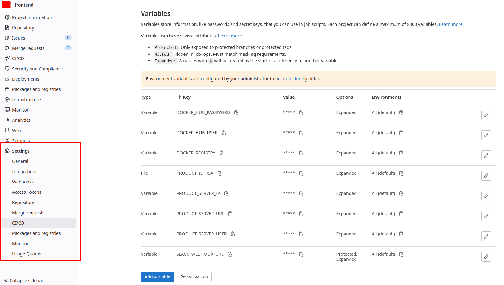

# Hướng dẫn setup CICD

CICD tự động deploy khi có tag mới như `v1.1.1`

## Thiết lập biến môi trường
Vào gitlab với tài khoản có quyền config cho dự án và bổ sung thêm trong mục CI/CD. Xuống phần `Variables` và bổ sung các key cho các dịch vụ đang sử dụng

### Các biến đang sử dụng
1. `SLACK_WEBHOOK_URL`: URL webhook của Slack để bắn notification khi deploy
2. `CI_REGISTRY`: URL docker registry, có thể là dockerhub mặc định hoặc registry local của công ty
3. `CI_COMMIT_REF_NAME`: Tag version của image.
4. `CI_PROJECT_NAME`: Tên dự án.
5. `PRODUCT_SERVER_URL`: URL sau khi dự án được build.
6. `PRODUCT_SERVER_USER`: tên user có quyền ssh vào server production.
7. `PRODUCT_SERVER_IP`: IP của server production.
8. `PRODUCT_ID_RSA`: SSH key để login vào server.
9. `CI_REGISTRY_USER`: user để login vào registry docker.
10. `CI_REGISTRY_PASSWORD`: password của user trên để login vào registry docker.
11. `CI_COMMIT_TAG`: Tag git commit để CICD tự đông build code khi đẩy lên nhánh main. Tag phải có định dạng `v1.2.3` theo chuẩn versioning

## Thiết lập file `.gitlab-ci.yml`
Giải thích các stage đang sử dụng:
1. install: cài đặt thư viện sử dụng yarn, chạy khi có:
   - merge request mới
   - commit mới trên nhánh default
   - khi có tag release mới
2. test: chạy test, lint, prettier, kiểm tra type:
   - merge request mới
   - commit mới trên nhánh default
   - khi có tag release mới
3. build-code
   - commit mới trên nhánh default
   - khi có tag release mới
4. build-docker
   - commit mới trên nhánh default
   - khi có tag release mới
5. deploy
   - commit mới trên nhánh default
   - khi có tag release mới
